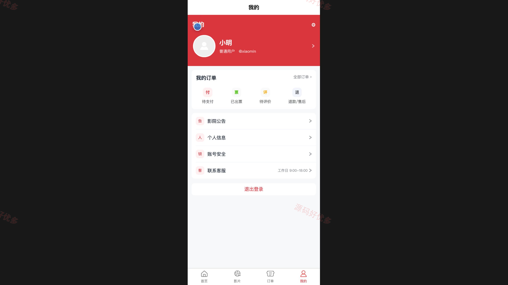
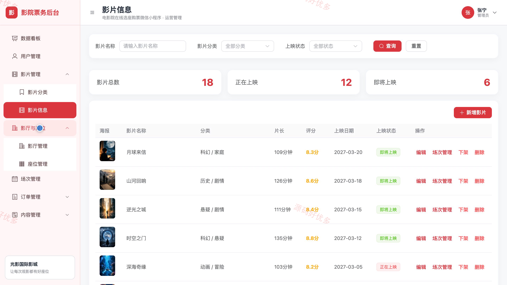
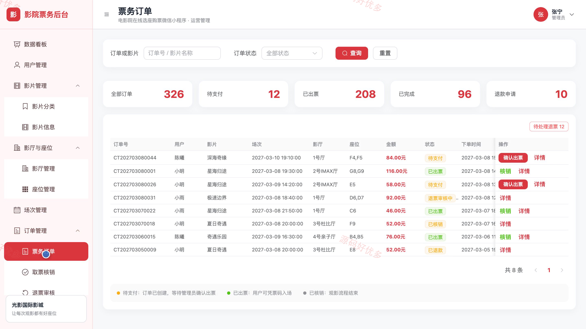
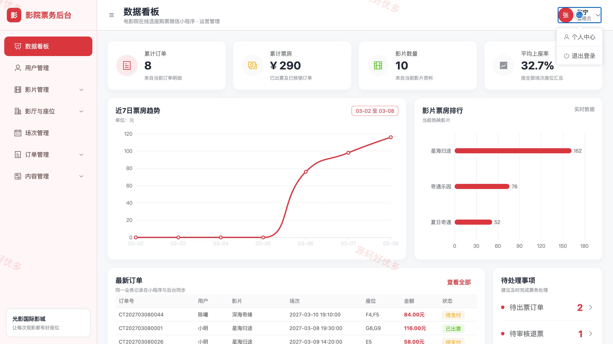

# bs005B
bs005B电影院预约订票小程序源码 Java SpringBoot3 Vue3 设计文档 PPT
## 源码问题查看主页咨询

### 一、关键词
在线电影票务、影院选座、电影场次、电子票、影城票务

### 二、作品包含
源码+数据库+万字设计文档+PPT+全套环境和工具资源+本地部署教程

### 三、项目技术
前端技术： Html、Css、Js、Vue3.4、Element-Plus、uniapp
后端技术：Java、SpringBoot3.2.0、MyBatis-Plus

### 四、运行环境（以下版本亲测，其他版本兼容性请自行测试）
开发工具：IDEA/eclipse + VSCODE + HBuilder X + 微信开发者工具

数据库：MySQL5.7+（共14张表）

数据库管理工具：Navicat10以上版本

环境配置软件： JDK17 + Maven3.6

前端Nodejs：16+

浏览器：谷歌浏览器

### 五、项目介绍
项目编号：bs005B

电影院预约订票小程序面向观影用户和影院管理员，连通影片与场次查询、在线选座购票、订单退票及票务运营管理流程。

角色：用户、管理员

用户功能：账号注册与个人资料维护、影片浏览搜索与个性化推荐、影片详情与放映场次查询、在线选座与座位锁定、订单创建及模拟支付与电子票、订单查看与未支付订单取消、退票申请与观影评价、影院公告与购票须知查看。

管理员功能：票房及上座率与热门影片数据看板、用户账号查询编辑与启停、影片分类及影片资料与上映状态管理、影厅资料与座位布局管理、影片场次及影厅票价与售票状态管理、票务订单查询与取票码核销、退票申请审核与订单状态处理、用户评价审核及影院公告与首页轮播管理。

### 六、运行截图

